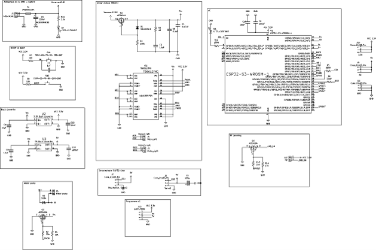
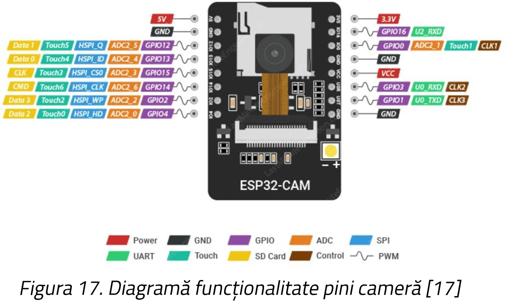
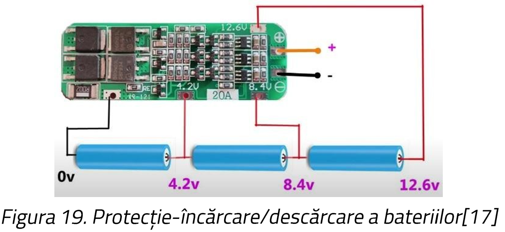
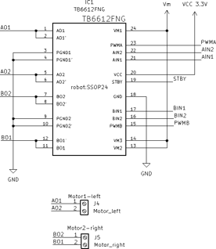
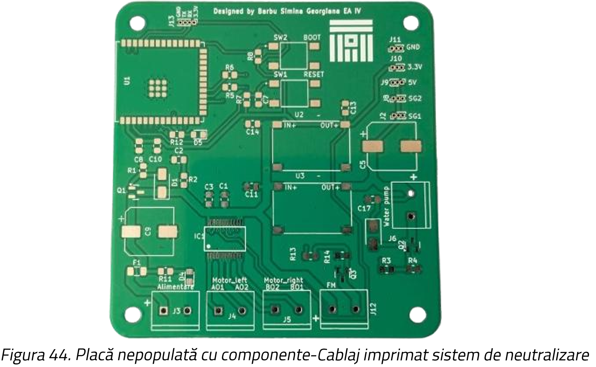

## Detailed Hardware Architecture

The hardware architecture of the tactical EOD robot is designed to ensure parallel and efficient task processing. It is divided into several dedicated subsystems, separating the main control logic from the video acquisition processes to minimize latency and optimize performance.

*(System Electrical Schematic)*

### 1. Main Processing Unit (ESP32-S3)
The core of the system is the **ESP32-S3-WROOM-1** microcontroller (Xtensa® dual-core 32-bit LX7 microprocessor). It acts as the master device, handling the general control of the system, motor driving, neutralization logic, and BLE communications.
* Integrated directly onto the custom PCB to optimize space and power consumption.
* Handles fast peripheral communication through customized SPI buses and generates precise PWM signals for the motors.

*(ESP32-S3 Pin Configuration for the Robot)*

### 2. Vision and Targeting System (ESP32-CAM)
A secondary module, the **ESP32-CAM**, is dedicated exclusively to video acquisition and AI processing. 
* Equipped with an **OV2640 CMOS sensor** providing up to 2 Megapixels (UXGA/SVGA resolution).
* Streams real-time video via Wi-Fi (HTTP server) directly to the Python Ground Control Station.
* Mounted on a custom Pan/Tilt gimbal controlled by two SG90 servo motors, allowing a wide field of view without rotating the entire robotic platform.

### 3. Power Supply and Energy Management
The robot is powered by a **12.6V 3S Li-Ion battery pack** (11.1V nominal), which directly supplies the high-current demands of the motors and water pump.
* **BMS (Battery Management System):** A 30A protection board is integrated to handle cell balancing, prevent overcharging (stops at 4.2V/cell), and protect against deep discharge.
* **Buck Converters:** Two high-efficiency Mini-360 step-down converters are used to provide stable logic voltages: one tuned for **3.3V** (powering the ESP32-S3, TB6612 driver, and RF module) and one tuned for **5V** (powering the ESP32-CAM, water pump, and servos).

*(3S Li-Ion BMS Configuration)*

### 4. Locomotion Subsystem
To control the tracks/wheels, the system uses the **TB6612FNG Dual H-Bridge motor driver** instead of the traditional L298N. 
* Features MOSFET technology with negligible voltage drops and extremely low thermal dissipation.
* Supports up to 1.2A continuous current per channel.
* Connected directly to the ESP32-S3 PWM pins to provide smooth, variable speed control and instant braking via a dedicated hardware Standby (STBY) pin.

*(TB6612FNG Motor Driver Schematic)*

### 5. Neutralization Actuators
* **Water Jet Disruptor:** Controlled via an **AO3400A power MOSFET**. The microcontroller triggers the gate (via GPIO 9) to close the high-current circuit of the hydraulic pump, generating the water jet required to short-circuit the explosive device.
* **RF Jammer:** Utilizes an **nRF24L01+** transceiver operating in the 2.4GHz spectrum. Connected via SPI, it rapidly sweeps through RF channels (29 to 90) transmitting a continuous noise carrier to jam unauthorized detonator signals. Its power is also controlled by a dedicated MOSFET for fail-safe deactivation.

### 6. Custom Printed Circuit Board (PCB)
To ensure robustness, save space, and avoid loose wiring, a custom 2-layer PCB was designed using **KiCad**.
* Features dedicated ground planes connected by vias to reduce electromagnetic interference (EMI).
* Uses thick 1.5mm traces for power delivery components (handling up to 2A) and 0.3mm/0.6mm traces for signal and logic routing.
* Incorporates a mix of SMD (Surface-Mount) and THD (Through-Hole) components for optimal layout.

  
  &nbsp; &nbsp;
  

*(Left: KiCad PCB Routing | Right: Fully Assembled and Soldered Custom Board)*
