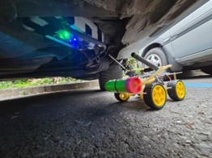
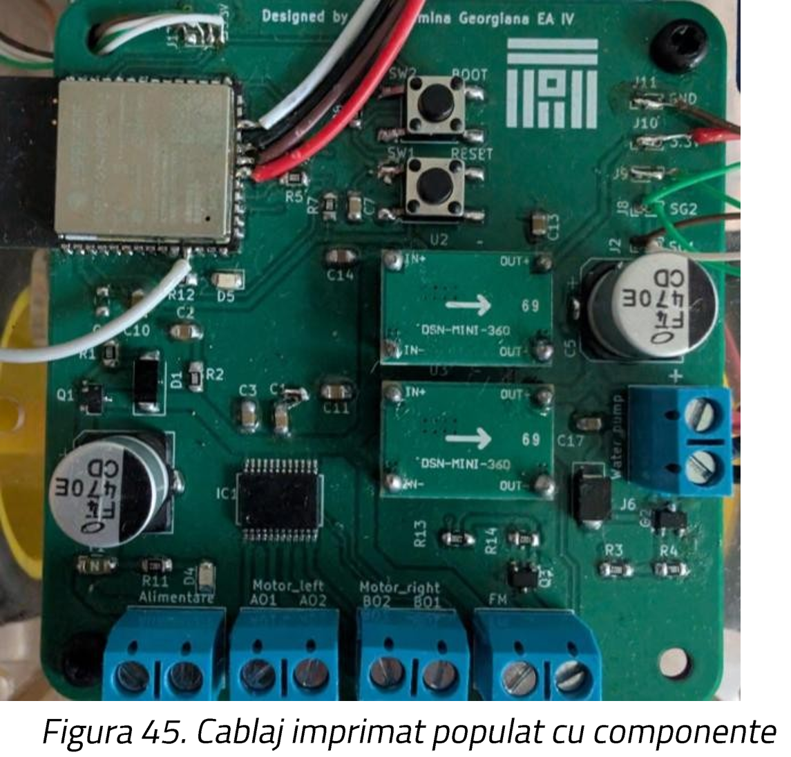
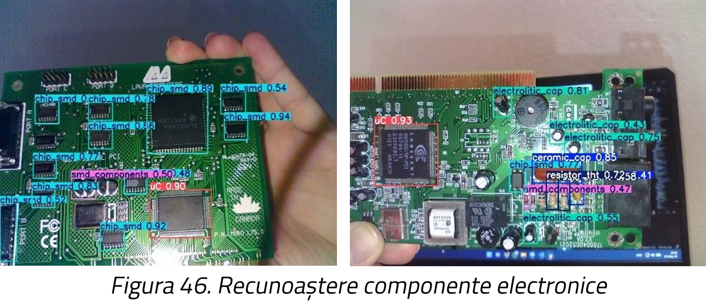

# Mobile Equipment for Neutralizing Explosive Devices (Tactical EOD Robot)

This repository contains the hardware design, firmware, and software for a remote-controlled tactical robotic platform designed to identify and safely neutralize explosive devices.

## Overview
The system is built around a Dual-Core ESP32-S3 microcontroller, acting as the central processing unit. It integrates an agile locomotion system, a dynamic vision system (ESP32-CAM), and two active neutralization methods:
1. **Physical Intervention**: A water pump disruptor designed to cause fatal short circuits in the target's electronics.
2. **Electronic Warfare**: An RF jamming module (nRF24L01) to block unauthorized remote communications (RCIEDs).

*(Image Reference: Tactical EOD Robot in operation)*

## Key Features
* **AI-Powered Object Detection**: Uses a custom-trained YOLOv8 convolutional neural network to automatically detect, classify, and frame electronic components of explosive devices in real-time.
* **Hybrid Wireless Communication**: Utilizes Bluetooth Low Energy (BLE) for low-latency telecommands and Wi-Fi for real-time video streaming.
* **Custom PCB**: A dedicated printed circuit board designed in KiCad that integrates the ESP32-S3, TB6612FNG motor drivers, and a 3S Li-Ion Battery Management System (BMS).
* **Advanced Ground Control Station**: A Python-based GUI built with Tkinter, featuring concurrent multi-threading for asynchronous control, video rendering, and AI inference.

*(Image Reference: Command Center GUI)*

## Hardware Architecture
* **Main Controller**: ESP32-S3.
* **Vision Module**: ESP32-CAM with an OV2640 sensor capable of SVGA resolution.
* **Locomotion**: DC Motors driven by highly efficient TB6612FNG H-bridges.
* **RF Jammer**: nRF24L01 module targeting the 2.4 GHz spectrum.
* **Power Supply**: 12.6V 3S Li-Ion battery pack with BMS and step-down buck converters (Mini360) for 5V and 3.3V logic.

*(Image Reference: Custom PCB Design)*

## Software Stack
* **Firmware (ESP32)**: Written in C/C++ (Arduino IDE) utilizing FreeRTOS for asynchronous task management and BLE GATT server implementation.
* **Ground Control Station**: Python application using `OpenCV` for video processing, `ultralytics` for YOLOv8 AI, and `bleak` for BLE communication.

*(Image Reference: Real-time Electronic Component Recognition)*

## Neutralization Mechanics
1. **Water Disruptor**: Simulates a high-velocity water jet to overwhelm the target microcontroller's ESD protection, causing thermal melting of silicon or dielectric breakdown.
2. **RF Jamming**: Generates a continuous noise carrier by rapidly sweeping through RF channels 29 to 90 (2.4 GHz band), preventing the detonation signal from reaching the bomb.
