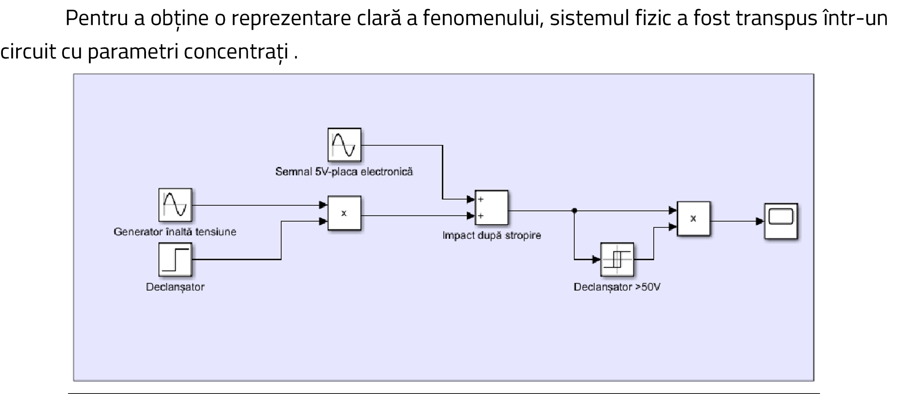
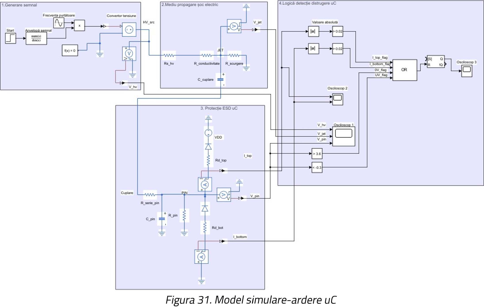
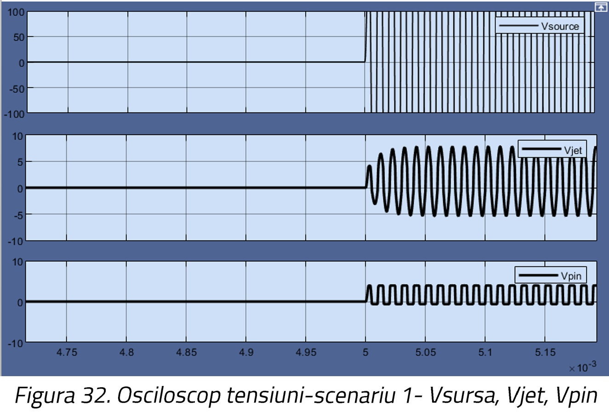
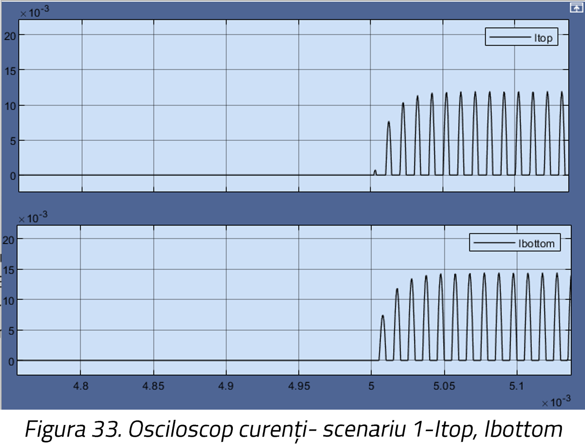
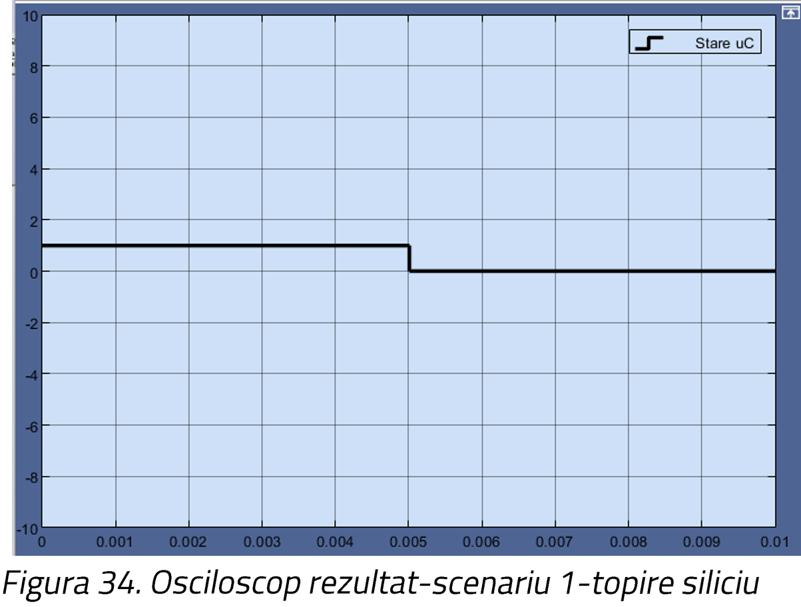
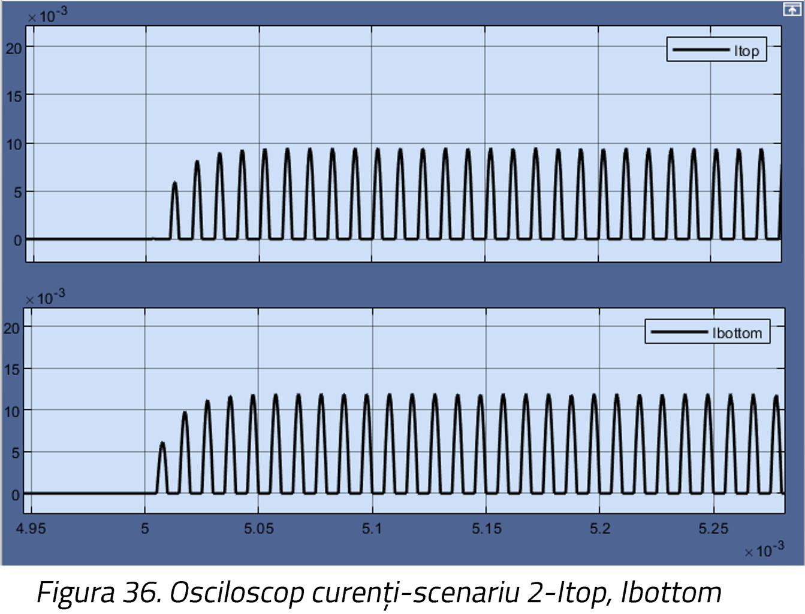
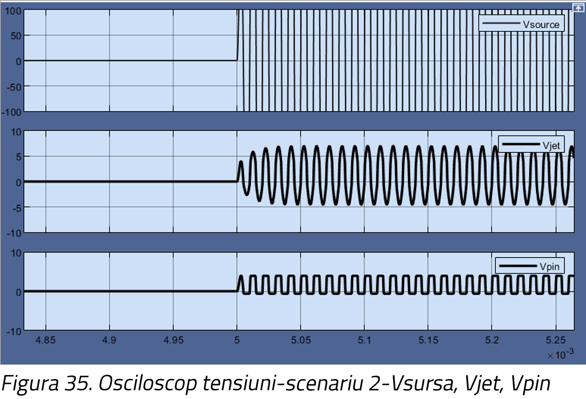
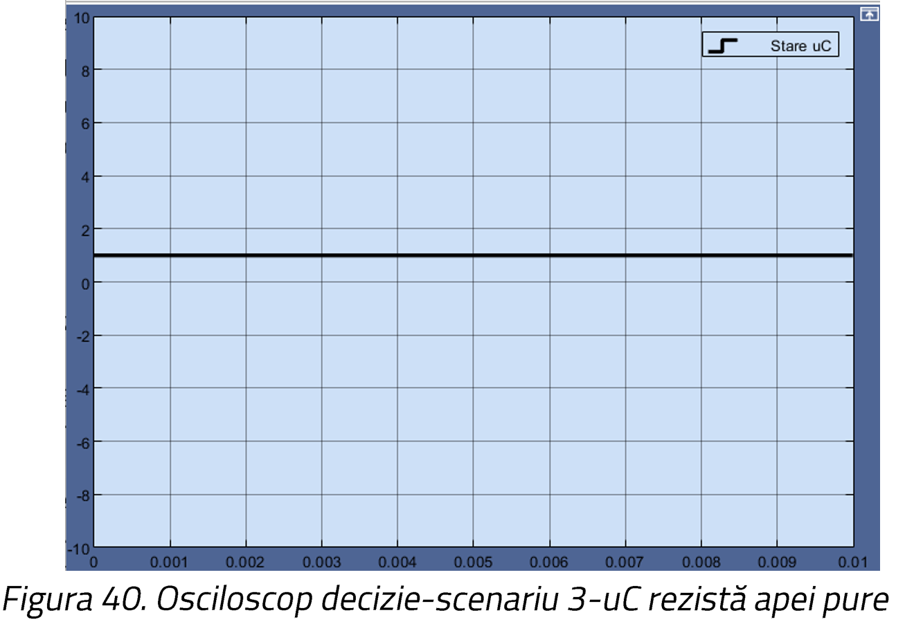

## Simulation and Validation: Water Disruptor System

To theoretically validate the effectiveness of the water jet neutralization method, a comprehensive simulation was developed using **MATLAB/Simulink**. The goal is to demonstrate how a high-voltage, high-frequency electromagnetic shock (simulating a Tesla Coil attack) propagates through a fluid medium (water jet) to fatally disrupt a target microcontroller.

### 1. Mathematical Logic of Neutralization
The first model translates the physical system into a lumped-parameter circuit. It simulates the exact moment the charged water jet physically hits the target, superimposing a massive high-voltage wave over the target's normal 5V operational circuit. 

*(Simulink Logic Model: Triggering the high-voltage impact on a 5V circuit)*

If the overvoltage exceeds the maximum tolerated threshold (e.g., 50V), a hysteresis block trips, simulating the irreversible burning of the silicon chip and shorting the circuit to ground.

### 2. Electrical Circuit Modeling (ESP32 Vulnerability)
Modern microcontrollers (like the ESP32) have internal ESD (Electrostatic Discharge) protection diodes. However, their efficiency is strictly limited by thermal dissipation. This simulation models the extreme scenario where these protections are overwhelmed.

The model incorporates:
* **High-Voltage Source**: 50,000V peak at 100 kHz.
* **Propagation Medium (Water Jet)**: Modeled with source series resistance, water column resistance ($R_{conductivitate}$), leakage resistance to ground, and coupling capacitance.
* **ESD Protection Diodes**: Simulating the internal CMOS architecture of the target chip.

*(Electro-hydrodynamic Attack Model on a Microcontroller)*

### 3. Experimental Scenarios

The severity of the attack depends directly on the conductivity of the water jet. We tested three different scenarios:

#### Scenario 1: Highly Conductive Water ($R_{conductivitate} = 50\Omega$)
In this scenario, the water acts as an excellent conductor. The ESD diodes on the target chip attempt to clamp the voltage between -0.6V and +3.9V.

*(Voltage Analysis: Source, Jet, and Pin Voltage)*

However, the current passing through the diodes reaches **20mA** on every sine wave peak. This exceeds the absolute maximum rating of the silicon junction.

*(Current Analysis: The fatal 20mA threshold is reached repeatedly)*

**Result:** **Thermal Destruction.** The extreme heat melts the silicon, permanently destroying the microcontroller.

#### Scenario 2: Moderate Conductivity ($R_{conductivitate} = 10k\Omega$)
Increasing the impedance of the liquid acts as a severe current limiter. The current spikes absorbed by the ESD diodes drop to approximately 8mA, saving the chip from thermal melting.

However, the voltage potential on the pin still exceeds the 3.6V absolute maximum limit of the CMOS architecture.

**Result:** **Dielectric Breakdown.** Even without thermal destruction, the high-voltage shock fatally compromises the microscopic insulation of the internal logic gates.

#### Scenario 3: Pure/Distilled Water ($R_{conductivitate} = 100M\Omega$)
Using an insulating fluid drastically changes the outcome. The massive impedance of the jet combined with leakage resistance causes the energy to dissipate into the environment before reaching the target.
* The voltage reaching the pin is practically zero.
* The current through the protection diodes remains at 0mA.

**Result:** **Survival.** None of the critical thresholds are breached. The target microcontroller remains fully functional.

*(Logic Decision: The chip survives the pure water attack)*

### Conclusion
The simulations mathematically prove that electro-hydrodynamic attacks using conductive water jets are highly effective at permanently neutralizing embedded systems by forcing either thermal runaway or dielectric breakdown.
